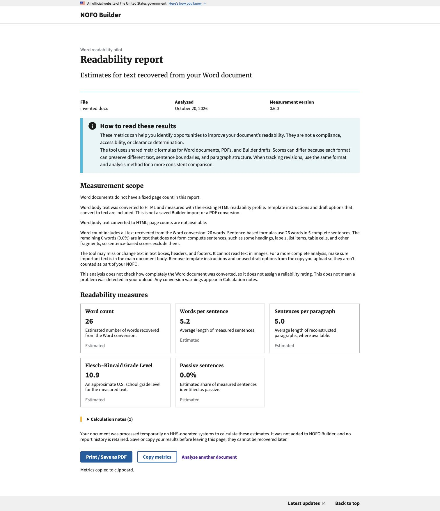
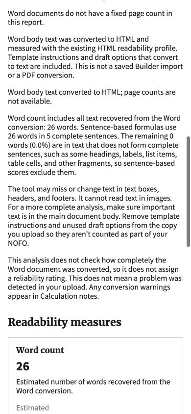

# Word report scope verification

October 20, 2026. Synthetic local account and invented Word text only.

## Investigation and implementation

The pinned 0.6.0 package's HTML pipeline intentionally omits PDF-estimate
reliability. The absent rating does not mean a check failed, and #1120 is not a
dependency. See [the source-linked investigation](../../readability/WORD_READABILITY_RELIABILITY.md).
Ordinary Word reports now use plain Measurement scope guidance, one explanation
of absent conversion-completeness assessment and Estimated metric labels.
Specific converter warnings remain in Calculation notes. PDF notices and
supplied ratings remain intact. No calculations or upload/access behavior changed.

## Checks

- 56 focused public/authenticated report and actual Word-worker tests passed.
  These cover real conversion, warnings, absent/supplied ratings and unchanged
  PDF variants. Full local suite: 2,697 Django tests, three existing skips, passed.
- All 57 JavaScript tests passed, including copied Word scope/guidance and
  existing print, copy fallback, calculation-note and progress behavior.
- Chrome: logged into a disposable local database, uploaded an invented DOCX
  through the authenticated form, and obtained all five measures. Verified no
  second blue scope alert or repeated absent-rating card labels. Copied the
  report and confirmed its scope explanation is present.
- Desktop and 390-pixel layout inspected; document and viewport widths both
  390 pixels. Temporary viewport override reset. Scope and metric-section
  headings both request Merriweather Web, 21.44px, weight 700; its web font is
  loaded. No heading styling or shared stylesheet changes were introduced.
- Browser printing uses the same report markup and existing print styles, but
  native print preview could not be inspected through automation after invoking
  the button. No saved PDF or manual pagination verification is claimed. The
  existing automated print/CSS checks passed.

No production data, saved NOFO, live permission change, provider call or
production deployment. Earlier design-pilot PRs were not modified by this fix.

